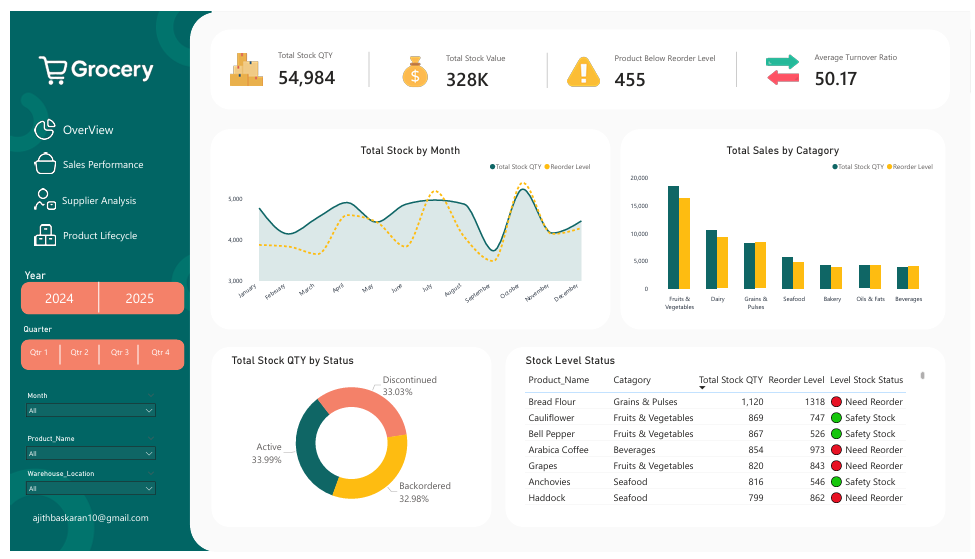
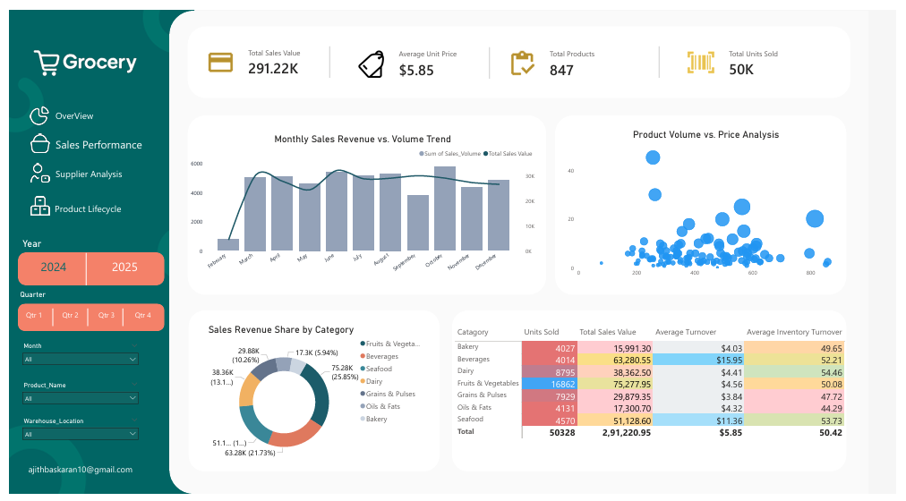
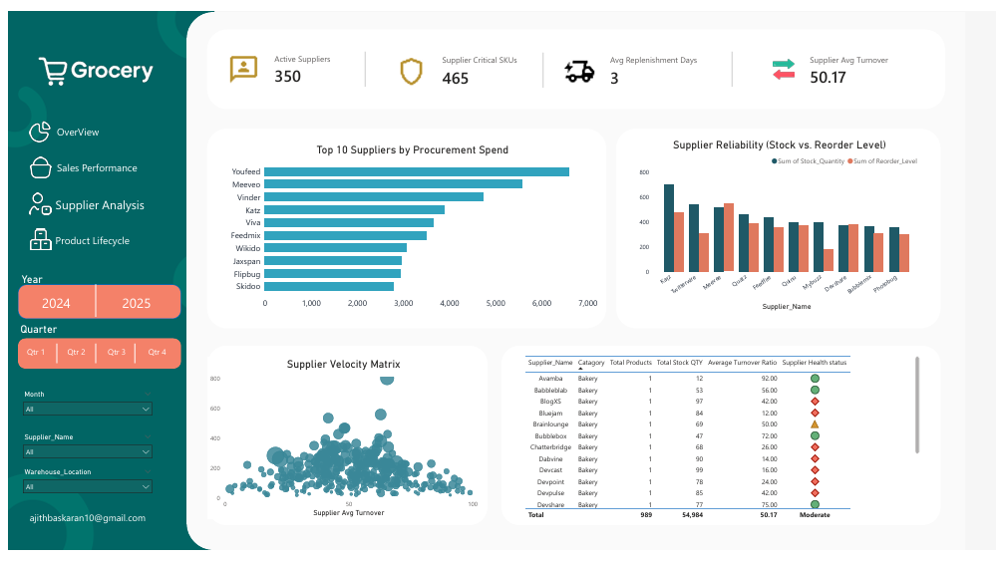
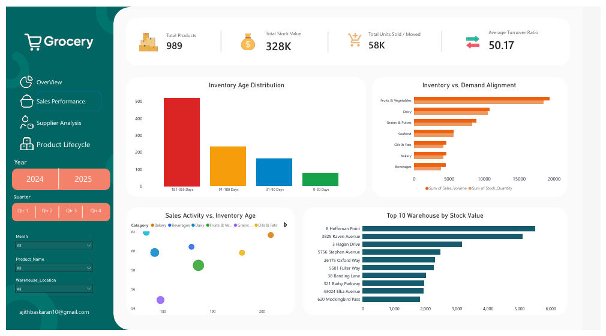

# 🛒 Grocery Inventory Management Dashboard | Power BI

## 📌 Project Overview

The **Grocery Inventory Management Dashboard** is a Power BI project designed to analyze grocery inventory operations, sales performance, supplier performance, and product lifecycle.

The main objective is to transform raw inventory data into meaningful business insights that help businesses monitor stock levels, identify products requiring restocking, analyze sales trends, and improve inventory management decisions.

## 🎯 Project Objectives

- Monitor overall inventory levels and stock availability.
- Identify products below their reorder levels.
- Analyze monthly sales performance and category-wise revenue.
- Evaluate supplier performance and procurement spending.
- Identify ageing inventory and slow-moving products.
- Analyze inventory and demand alignment.
- Support data-driven business decisions.

## 🛠️ Tools & Technologies

- **Microsoft Power BI** – Dashboard development and visualization.
- **Power Query** – Data cleaning and transformation.
- **DAX** – KPI calculations and business measures.
- **Data Modeling** – Organizing data for reporting and analysis.

## 📊 Dashboard Overview

This project contains four interactive dashboard pages.

### 1. Overview Dashboard

Provides a complete overview of grocery inventory operations.

**Key KPIs:**
- Total Stock Quantity: 54,984
- Total Stock Value: 328K
- Products Below Reorder Level: 455
- Average Turnover Ratio: 50.17

**Visualizations:**
- Total Stock by Month
- Stock Quantity vs Reorder Level by Category
- Total Stock Quantity by Status
- Stock Level Status by Product

**Business Purpose:** Helps identify inventory shortages, monitor stock availability, and understand the overall inventory position.

#### 📸 Dashboard Screenshot



---

### 2. Sales Performance Dashboard

Analyzes sales trends, product pricing, and category-wise revenue.

**Key KPIs:**
- Total Sales Value: $291.22K
- Average Unit Price: $5.85
- Total Products: 847
- Total Units Sold: 50,328

**Visualizations:**
- Monthly Sales Revenue vs. Volume Trend
- Product Volume vs. Price Analysis
- Sales Revenue Share by Category
- Category-wise Sales Performance

**Business Purpose:** Helps understand sales trends, identify high-performing categories, and evaluate product sales performance.

#### 📸 Dashboard Screenshot



---

### 3. Supplier Analysis Dashboard

Evaluates supplier performance, procurement spending, and stock reliability.

**Key KPIs:**
- Active Suppliers: 350
- Supplier Critical SKUs: 465
- Average Replenishment Days: 3
- Supplier Average Turnover: 50.17

**Visualizations:**
- Top 10 Suppliers by Procurement Spend
- Supplier Reliability (Stock vs. Reorder Level)
- Supplier Velocity Matrix
- Supplier Performance Table

**Business Purpose:** Helps compare suppliers, identify potential supply risks, and monitor supplier-related inventory performance.

#### 📸 Dashboard Screenshot



---

### 4. Product Lifecycle Dashboard

Analyzes inventory ageing, product movement, and warehouse stock distribution.

**Key KPIs:**
- Total Products: 989
- Total Stock Value: 328K
- Total Units Sold / Moved: 58K
- Average Turnover Ratio: 50.17

**Visualizations:**
- Inventory Age Distribution
- Inventory vs. Demand Alignment
- Sales Activity vs. Inventory Age
- Top 10 Warehouses by Stock Value

**Business Purpose:** Helps identify ageing inventory, understand demand patterns, and monitor warehouse stock distribution.

#### 📸 Dashboard Screenshot



---

## 🔍 Key Business Insights

The analysis provided the following findings:

- **455 Products Below Reorder Level:** Identified products that may require replenishment.
- **46% Below Reorder Level:** Highlighted a significant portion of products requiring stock-level attention.
- **Approximately 33% Inactive Inventory:** Identified products with no activity for more than 181 days, indicating potential slow-moving or ageing stock.

These findings can help businesses improve stock replenishment planning, monitor ageing products, and make better purchasing decisions.

## 📈 Business Benefits

- Better inventory visibility.
- Improved stock replenishment planning.
- Identification of potential stockout risks.
- Better understanding of sales performance.
- Improved supplier performance monitoring.
- Identification of ageing and slow-moving inventory.
- Data-driven inventory management decisions.

## 📂 Repository Structure

```text
Grocery-Inventory-Management/
│
├── Dashboard/
│   ├── Grocery_Inventory_Management.pbix
│   └── Grocery_Inventory_Management.pdf
│
├── Dataset/
│   └──Grocery_Inventory.csv
│   
├── Icons/
│   ├── Active_Supplier.png
│   ├── arrows.png
│   ├── caution.png
│   ├── Credit_Card.png
│   ├── Delivery_Truck.png
│   ├── Grocery_Inventory_Dashboard_Background.png
│   ├── Grocery_Logo.png
│   ├── Inventory.png
│   ├── money-bags.png
│   ├── packages.png
│   ├── Shield.png
│   └── Shopping_Cart.png
│
├── Images/
│   ├── overview.png
│   ├── sales performance.png
│   ├── supplier analysis.png
│   └── product lifecycle.png
├── README.md
```

## 🚀 Key Learnings

Through this project, I gained practical experience in:

- Building interactive Power BI dashboards.
- Data cleaning and transformation using Power Query.
- Creating DAX measures and KPIs.
- Analyzing inventory and sales performance.
- Understanding supplier performance metrics.
- Translating business data into actionable insights.
- Designing multi-page business intelligence reports.

## 👨‍💻 Author

**Ajith Baskaran**

Aspiring Data Analyst | SQL | Python | Excel | Power BI | Statistics

- GitHub: https://github.com/ajith-data
- LinkedIn: https://linkedin.com/in/ajithbaskaran

---

⭐ If you find this project useful, feel free to explore the repository and share your feedback!
